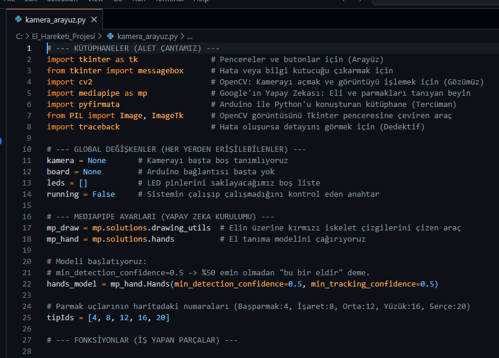
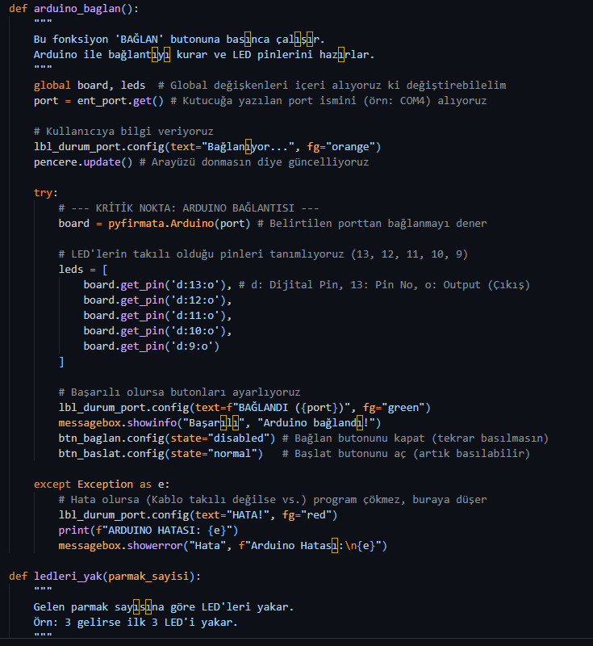
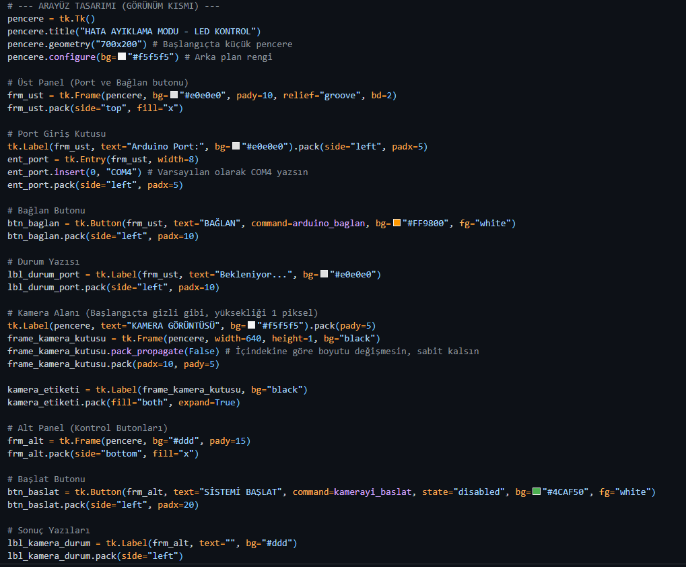
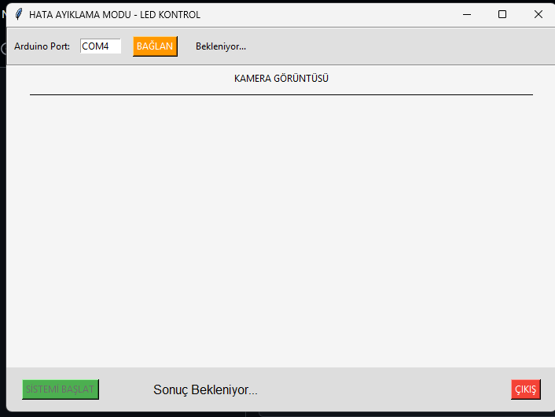
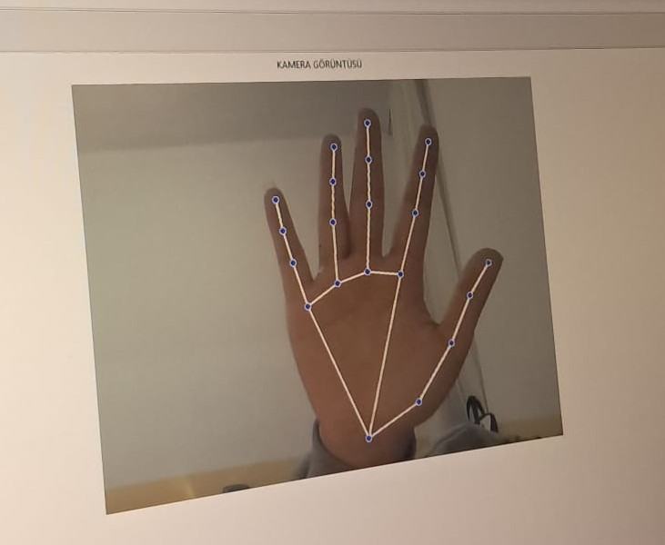

# Python-OpenCV-Arduino-Control

Kamera üzerinden el ve parmak hareketlerini gerçek zamanlı olarak algılayan ve tespit edilen parmak sayısına göre Arduino'ya bağlı 5 adet LED'i fiziksel olarak kontrol eden bilgisayarlı görü (computer vision) ve gömülü sistem projesidir.

Proje, Google MediaPipe el izleme modelini OpenCV görüntü işleme altyapısıyla birleştirir; Tkinter tabanlı masaüstü arayüzü sayesinde seri port bağlantısını ve kamera akışını tek bir panelden yönetir.

---

## Ozellikler

* **Gercek Zamanli El ve Eklem Tespiti:** MediaPipe Hands modeli ile 21 el eklem noktası (landmarks) 30+ FPS hızında anlık olarak takip edilir.
* **Parmak Sayma Algoritmasi:** Başparmak için X ekseni bağıl konumu, diğer dört parmak için Y ekseni boğum yükseklikleri hesaplanarak 0 ile 5 arası parmak sayısı doğru şekilde belirlenir.
* **Donanim Entegrasyonu:** Algılanan parmak sayısına paralel olarak Arduino'daki dijital pinler (9, 10, 11, 12, 13) üzerinden ilgili sayıda LED yakılır.
* **Masaustu Kontrol Paneli:** Tkinter ile geliştirilmiş, port seçimi, bağlantı durumu takibi, canlı kamera önizlemesi ve hata bildirimlerini içeren grafik arayüz.
* **Kilitlenmeyen Arayuz Mimarisi:** Görüntü döngüsünde arayüzü donduran `while True` yerine Tkinter'ın olay tabanlı zamanlayıcısı (`after`) kullanılmıştır.

---

## Kullanilan Teknolojiler

* **Programlama Dili:** Python 3.10+
* **Goruntu Isleme & Yapay Zeka:** OpenCV (`cv2`), Google MediaPipe
* **Arayuz (GUI):** Tkinter, Pillow (PIL)
* **Haberlesme & Gömülü Sistem:** pyFirmata, PySerial, Arduino (C++)

---

## Donanim Baglantilari ve Pin Yapilandirmasi

Sistemde 5 adet LED ve 1 adet Arduino Uno / Nano kartı kullanılmaktadır:

| Bilesen | Arduino Pini | Gorev |
| :--- | :--- | :--- |
| LED 1 | Dijital Pin 13 | 1. Parmak acikken aktif |
| LED 2 | Dijital Pin 12 | 2. Parmak acikken aktif |
| LED 3 | Dijital Pin 11 | 3. Parmak acikken aktif |
| LED 4 | Dijital Pin 10 | 4. Parmak acikken aktif |
| LED 5 | Dijital Pin 9  | 5. Parmak acikken aktif |
| Direncler | 220 Ohm / 330 Ohm | Her LED'in katot (-) hattına seri bağlı |
| Toprak | GND | Ortak katot hattı |

* **Varsayilan Baud Rate:** 9600 bps (Seri haberleşme taslağında) / 57600 bps (StandardFirmata protokolünde).

---

## Kurulum ve Calistirma

### 1. Arduino Kurulumu (Iki Yontemden Biri)

**Yontem A (Tavsiye Edilen - Standart Firmata):**
Python kodundaki `pyfirmata` entegrasyonunu doğrudan çalıştırmak için:
1. Arduino IDE'yi açın.
2. `Dosya` > `Ornekler` > `Firmata` > `StandardFirmata` yolunu izleyin.
3. Kartınızı bilgisayara bağlayıp kodu Arduino'ya yükleyin.

**Yontem B (Ozel Seri Port Kodu):**
Depoda bulunan `arduino_led_kontrol.ino` dosyasını Arduino IDE ile açıp doğrudan karta yükleyebilirsiniz.

### 2. Python Ortaminin Hazirlanmasi

Depoyu bilgisayarınıza klonlayın veya indirin:
```bash
git clone https://github.com/SenanurCodes/Python-OpenCV-Arduino-Control.git
cd Python-OpenCV-Arduino-Control
```

Gerekli bağımlılıkları yükleyin:
```bash
pip install -r requirements.txt
```

### 3. Uygulamanin Calistirilmasi

Ana arayüzü başlatmak için:
```bash
python kamera_arayuz.py
```

1. Açılan pencerede Arduino'nun bağlı olduğu portu girin (Örn: `COM3`, `COM4` veya Linux/macOS için `/dev/ttyUSB0`).
2. **BAGLAN** butonuna tıklayın.
3. Bağlantı sağlandıktan sonra **SISTEMI BASLAT** butonuna tıklayarak kamera akışını başlatın.
4. Kameraya gösterdiğiniz parmak sayısına göre LED'lerin yandığını gözlemleyin.

---

## Proje Yapisi

```text
Python-OpenCV-Arduino-Control/
├── arduino_led_kontrol.ino            # Arduino C++ seri haberleşme ve LED kontrol taslağı
├── kamera_arayuz.py                   # MediaPipe el takibi, OpenCV ve Tkinter masaüstü uygulaması
├── requirements.txt                   # Gerekli Python kütüphaneleri listesi
├── README.md                          # Proje dokümantasyonu
└── gorseller/
    ├── demo-1-baglanti-arayuzu.png    # Başlangıç port bağlantı arayüzü
    ├── demo-2-el-tespiti.png          # MediaPipe eklem tespiti ve tek parmak LED kontrolü
    ├── demo-3-led-kontrol-canli.png   # 5 parmak açık durumundaki canlı çalışma ekranı
    ├── arduino-devre-baglantisi.png   # Arduino devre ve pin bağlantı şeması
    └── mediapipe-el-eklemleri-haritasi.jpeg # MediaPipe 21 eklem referans haritası
```

---

## Ekran Goruntuleri

### Masaustu Arayuzu ve Baglanti


### El Tespiti ve Canli LED Kontrolu




### Arduino Devre Yapilandirmasi ve MediaPipe Eklem Referansi




---

## Gelistirme Notlari

* **Kamera Gecikmesi ve FPS:** MediaPipe parametrelerinde `min_detection_confidence=0.5` ve `min_tracking_confidence=0.5` değerleri seçilerek işlemci yükü dengelenmiş ve gerçek zamanlı tepki süresi korunmuştur.
* **Hata Yonetimi:** Seri port kesintisi ya da kamera bağlantı kaybı durumlarında uygulamanın aniden kapanmasını önlemek için hata blokları (`try-except`) ve Tkinter `messagebox` uyarıları eklenmiştir.
* **Kaynak Yonetimi:** `ÇIKIŞ` fonksiyonu üzerinden uygulama sonlandırıldığında açık kamera portu serbest bırakılmakta (`release`) ve donanımdaki tüm LED'ler sıfırlanmaktadır.
